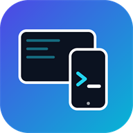

# 默默ADB（momoadb）

  

默默ADB 是一款运行在 Android 手机、平板与电视上的 ADB 管理工具，通过 WiFi ADB / 无线调试或 USB OTG 管理手机、平板、电视和电视盒子。

## 功能特性

- 无线调试配对、连接、断开和最近设备记录
- 扫码连接与显示本机连接二维码：扫描目标设备的二维码自动填写 IP 和端口，也可展示本机二维码供其他设备反向扫码连接
- USB OTG 连接 ADB / Fastboot；Fastboot 支持设备摘要、重启快捷按钮、命令查询和结果复制
- 局域网自动发现和网段扫描，快速发现 adb 设备
- 查看设备基础信息、连接状态和截图
- 应用列表、分类筛选、搜索、启动、停止和卸载
- 本地 APK 安装，在线下载 APK 后安装到目标设备
- 本机用户应用导出并安装到目标设备
- 在线下载文件并推送到目标设备
- 目标设备文件管理、目录浏览、本地文件上传和设备文件下载
- 设备截图预览，需要时再保存到本机
- 目标设备系统日志查看和复制
- 模拟物理按键、虚拟遥控器和屏幕镜像
- Shell 命令执行和输出查看
- 诊断日志记录错误信息，便于排查连接和功能异常
- 默认端口、连接超时、命令超时、镜像画质和主题设置
- 应用内检查更新，发现新版本可直接前往发布页下载
- 手机与大屏设备自适应的界面：手机上使用底部导航，电视与电视盒子使用左侧导航与遥控器方向键操作

## 使用

1. 无线连接：在目标设备开启开发者选项和无线调试，在 默默ADB 中输入 IP 和 ADB 端口，或先进行无线调试配对。
2. USB 连接：使用支持数据传输的 OTG 线连接，允许本机访问 USB 设备，并在目标设备确认 USB 调试授权；Fastboot 模式可直接从 USB OTG 列表连接。
3. 连接成功后进入设备详情页，使用应用管理、APK 安装、文件管理、截图、遥控器、屏幕镜像或 Shell 等功能。
4. 常用 WiFi 设备会自动保存到最近设备列表，后续可快速回填连接信息。

运行环境：Android 7.0（API 24）及以上。电视端使用遥控器方向键操作，确认键等同点击。

屏幕镜像的控制区可以隐藏，输入键盘默认关闭，可通过顶部键盘按钮独立打开和关闭。

## 版本说明

- **标准版**：Android 7.0 及以上，包含上面列出的全部功能，电视与盒子上使用遥控器操作。
- **轻量版**：面向 Android 4.4（API 19）的电视与盒子，传统界面、无第三方依赖。打开即显示本机连接信息与二维码，配合标准版的「扫码连接」一键连接被控设备；连接、设备信息、截图、APK 安装、文件上传下载、按键模拟、重启与 Shell 命令等操作位于「高级功能」页。

两个版本使用不同的包名，可以同时安装在同一台设备上。

## 技术栈

- Kotlin
- Jetpack Compose
- Material 3
- Kadb 2.1.5 + kadb-mdns 2.1.4
- ZXing（扫码连接与二维码生成）
- scrcpy-server 5.0.1
- Coroutines / Flow
- DataStore
- OkHttp

详细实现、构建验证和维护规范见 [开发文档](docs/DEVELOPMENT.md)。

## 致谢

- [Kadb](https://github.com/flyfishxu/Kadb)
- [scrcpy](https://github.com/Genymobile/scrcpy)
- 上游项目 sky adb（[sky22333](https://github.com/sky22333)）

## 作者

莫莫先生 · [GitHub](https://github.com/hcllmsx) · [B 站](https://space.bilibili.com/255947051)

## 开源许可

基于 GPL-3.0 协议开源，详见 [LICENSE](LICENSE)。
